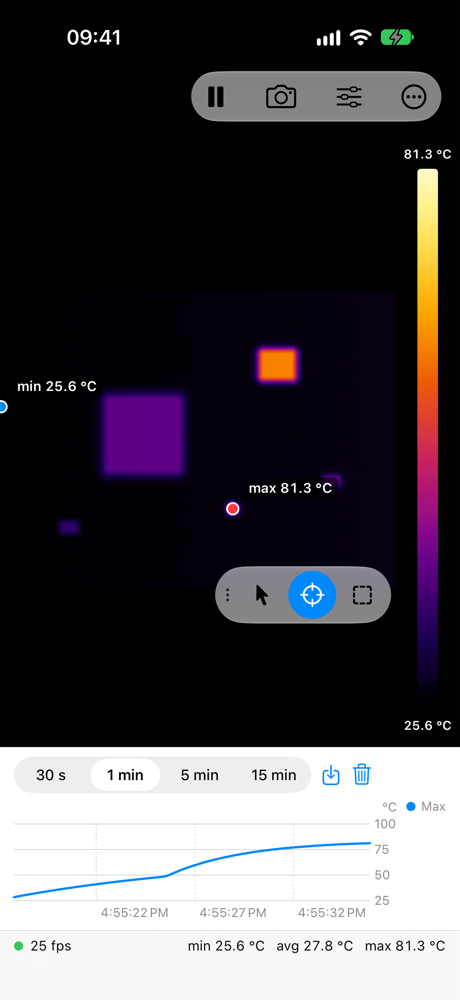

# Thermal Inspector

A native app for **macOS, iPhone and iPad** for the **ThermalMaster P3** USB
thermal camera, made for inspecting circuit boards: find shorts, overheating
parts and bad joints.

Written in SwiftUI. On the Mac it talks to the camera directly via Apple's
IOUSBHost framework, on iPhone/iPad as an MFi accessory – no drivers, Python or
libusb needed.


## Features

| Feature | Why it helps on a PCB |
|---|---|
| Live image at 25 fps, 6 color palettes | |
| **Spots** (click) and **boxes** (drag) with live max / average / min – movable with the pointer tool | Watch regulators, ICs, specific parts |
| Hottest / coldest pixel markers | Find the fault without searching |
| **Difference image (ΔT)**: capture the unpowered board, then power it on | Shows only the heating – shorts and leaky capacitors jump out, reflections cancel out |
| **Isotherm**: only areas above a threshold are colored | "Which parts exceed 70 °C?" |
| **Detail view**: the camera's own contrast-enhanced image | Recognize component outlines; measurements still use temperatures |
| Automatic or fixed temperature range | A fixed range keeps images comparable |
| Emissivity with material presets, reflected temperature | Correct readings on solder mask, ICs, ceramics |
| Noise filter (averaging 2–16 frames) | Makes fractions of a degree visible |
| **Drift indicator**: shows how much each automatic recalibration of the camera corrected | Know when readings are trustworthy |
| **Temperature history** chart for all measurements, CSV export | Warm-up behavior, thermal runaway |
| Snapshot: annotated PNG + full temperature matrix (CSV) + results (JSON) | Documentation and later analysis |
| Video recording (MP4, with overlays) | |
| Rotate / mirror | Camera mounted on a stand above the board |
| Gain −20…150 °C (sensitive) or 100…600 °C, shutter / recalibration | |
| Automatic shutter can be switched off | No sudden jumps during a measurement or recording |
| Camera image settings for the Detail view: brightness, contrast, noise reduction, detail enhancement | Outlines of components stand out better |
| Burn-in protection (on by default) | The camera closes its shutter when it sees the sun or a laser |
| English and German, settings window (⌘,) | |
| Demo mode with a simulated board | Try the app without a camera |
| **iPhone and iPad** version | Take the camera to the workbench without a laptop |

## Requirements

* **Mac:** macOS 15 (Sequoia) or newer, Apple Silicon or Intel
* **iPhone/iPad:** iOS/iPadOS 18 or newer. Devices with Lightning need Apple's
  "Lightning to USB 3 Camera Adapter" (tested with an iPhone 14 Pro)
* A **ThermalMaster P3** (USB ID `3474:45A2`). These cameras are also sold under
  other names; any camera with this USB ID should work. The P1 (`3474:45C2`) is
  supported by the protocol code but has not been tested.

## Installation on the Mac

1. Download `Thermal-Inspector-<version>.zip` from the
   [Releases](../../releases) page and double-click it to unzip.
2. Move **Thermal Inspector.app** to your **Applications** folder.
3. Allow the app to open (once) – see below.

### Opening the app for the first time

The app is **not signed with an Apple developer certificate** and not notarized
by Apple. macOS therefore blocks it the first time and says it cannot verify the
app. You have to allow it explicitly – only once:

1. Double-click **Thermal Inspector**. macOS shows a message that the app was
   not opened. Click **Done** (do *not* click "Move to Trash").
2. Open **System Settings → Privacy & Security**.
3. Scroll down to the **Security** section. There is a note that
   "Thermal Inspector" was blocked. Click **Open Anyway**.
4. Confirm with your password or Touch ID, then click **Open Anyway** once more.

From now on the app opens normally.

<details>
<summary>Alternative: Terminal</summary>

Removing the quarantine flag that macOS adds to downloaded files has the same effect:

```bash
xattr -dr com.apple.quarantine "/Applications/Thermal Inspector.app"
```

</details>

**Why unsigned?** Signing and notarizing requires a paid Apple developer
account. If you prefer not to trust a downloaded binary, build the app yourself
from the source code (see below) – that takes about a minute.

## Usage

1. Plug in the camera. The app finds it automatically (also when plugged in later).
2. Choose a tool in the toolbar:
   **Pointer** – read temperatures, drag spots and boxes to move them ·
   **Spot** – click to place · **Box** – drag to draw.
3. Snapshots (⌘S) and videos (⌘R) are saved to `~/Pictures/Thermal Inspector/`
   (configurable in the settings).

No camera at hand? Choose **Demo (simulated board)** as the source.

### Keyboard shortcuts

| | |
|---|---|
| ⌘S | Save snapshot |
| ⌘R | Start / stop video |
| ⌘F | Freeze image |
| ⌘D / ⇧⌘D | Capture reference / toggle difference image |
| ⌘L | Lock current temperature range |
| ⌘K | Shutter / recalibrate |
| ⌘⌫ | Remove all measurements |
| ⌘, | Settings |

### Tips for PCB work

* **Let the camera warm up.** Right after plugging in, the P3 drifts by several
  kelvin between its automatic recalibrations (every ~90 s). The drift indicator
  shows this. For accurate readings wait a few minutes, or press ⌘K right before measuring.
* **Bare metal** (solder, tinned pads, heat sinks) reflects instead of emitting –
  readings are far too low. Put a piece of matte black electrical tape on it and use ε = 0.95.
* **Finding shorts:** capture the reference with the board **off**, power it on and
  watch the ΔT image.
* Use the noise filter and a fixed range when looking for small differences.
* The fixed-focus lens gets blurry very close up; a clip-on macro lens helps for
  fine-pitch parts.

## Building from source

Requires a recent Xcode (tested with Xcode 27; uses macOS 15 APIs) and [XcodeGen](https://github.com/yonaskolb/XcodeGen):

```bash
brew install xcodegen
./build.sh
```

The app is then in `build/Build/Products/Release/`. Alternatively run
`xcodegen generate` and open `Thermal Inspector.xcodeproj` in Xcode.

### Development

| | |
|---|---|
| Tests | `xcodebuild -project "Thermal Inspector.xcodeproj" -scheme "Thermal Inspector" -derivedDataPath build test` |
| iOS build | `xcodebuild -project "Thermal Inspector.xcodeproj" -scheme "Thermal Inspector iOS" -sdk iphonesimulator build` |
| Translations | All texts live in `ThermalInspector/Resources/Localizable.xcstrings`. After a build, `python3 Tools/check-localizations.py` lists texts without translation. |
| App icons | Generated by `Tools/make-icon.swift` (`--ios` for the iPhone/iPad icon) |
| Release zip | `./Tools/make-release.sh` → `dist/` (universal, ad-hoc signed, checks that no local paths end up in the app) |
| USB analysis | `Tools/usb-capture-filter.c` and `Tools/usb-capture-summary.py` shrink and summarize captures of a hardware USB sniffer (see docs/HARDWARE-NOTES.md) |
| Try a language | Launch with `-AppleLanguages "(de)"` |

Code layout – one code base for macOS and iOS; only `Platform/` differs:

```
ThermalInspector/
  Camera/     Protocol, frame parsing, demo camera, camera thread
  Thermal/    Temperature frames, radiometry (emissivity), palettes, rendering
  Analysis/   Measurements, temperature history, calibration (drift) detection
  Export/     Snapshots, annotated images, video recording
  App/        Central AppModel, preferences
  Views/      SwiftUI views (adapt to Mac, iPad and iPhone)
  Resources/  App icons and translations
  Platform/
    macOS/    App entry, USB driver (IOUSBHost)
    iOS/      App entry, accessory connection (External Accessory)
ThermalInspectorTests/  Unit tests
Tools/        Icon generator, translation check, release script, USB capture analysis
Experiments/  AccessoryProbe – test app for the iOS accessory connection
docs/         Hardware notes, screenshots
```

## iPhone and iPad



The P3 is an MFi accessory: iOS lets apps talk to it through Apple's External
Accessory framework, and the camera streams the same data as over USB. The
iPhone/iPad app has the same measuring and camera features as the Mac app
(range, shutter, automatic shutter, image settings), with these differences:

* The shutter has its own button in the top bar.
* The tools float on the image as a small glass capsule – drag it anywhere if
  it is in the way.
* Touch the image to read temperatures (pointer tool); the readout is shown
  above your finger.
* Files are saved in the Files app under *On My iPhone/iPad → Thermal Inspector*.
* The language is set per app in the system Settings app.

### Installing it on your iPhone or iPad

The app is not in the App Store (apps for MFi accessories need the camera
maker's approval there). You build and install it yourself with Xcode – a free
Apple ID is enough. The project contains no signing team; Xcode signs the app
with **your** account.

1. Install **Xcode** from the Mac App Store and open it once.
2. Clone this repository and open `Thermal Inspector.xcodeproj`.
3. Add your Apple ID: **Xcode → Settings → Accounts → +**.
4. Select the scheme **Thermal Inspector iOS** in the toolbar.
5. Select the **Thermal Inspector iOS** target → **Signing & Capabilities** → choose
   your team (a free account shows up as "Your Name (Personal Team)"). The bundle
   identifier gets your team ID appended automatically, so it is unique.
6. Connect the iPhone/iPad with a cable, unlock it, tap **Trust** if asked, and
   select it as run destination.
7. On the device, enable **Developer Mode**: *Settings → Privacy & Security →
   Developer Mode* (it asks to restart).
8. Press **Run** (⌘R). With a free account the first start is blocked: on the
   device open *Settings → General → VPN & Device Management*, tap your Apple ID
   and choose **Trust**. Then start the app again.

With a free account the app stops working after 7 days – just press Run in Xcode
again. A paid developer account extends this to one year.

Choosing a team writes your team ID into `project.pbxproj`; don't commit that
change (`xcodegen generate` removes it again).

[Experiments/AccessoryProbe](Experiments/AccessoryProbe/README.md) is a small
test app to explore the camera's External Accessory connection, e.g. to find
the command channel.
<br clear="right">

## How the camera works

The P3 is not a standard webcam: it uses vendor-specific USB commands and
streams raw temperature data. What is known – including findings made while
building this app (more registers, a firmware debug log, the automatic
recalibration) – is collected in [docs/HARDWARE-NOTES.md](docs/HARDWARE-NOTES.md).

## Credits and license

The USB protocol is a Swift port of the Python driver from
[Thermal Camera Viewer](https://github.com/skywalker1905/thermal-camera-viewer),
which builds on [p3-ir-camera](https://github.com/jvdillon/p3-ir-camera) and the
USB traffic analysis by @aeternium. Thank you!

Made by Timo Schrappe. Licensed under the [Apache License 2.0](LICENSE); see [NOTICE](NOTICE).

This project is not affiliated with or endorsed by ThermalMaster or InfiRay.
Temperature readings of low-cost thermal cameras are approximate – do not rely
on them for safety-critical decisions.
