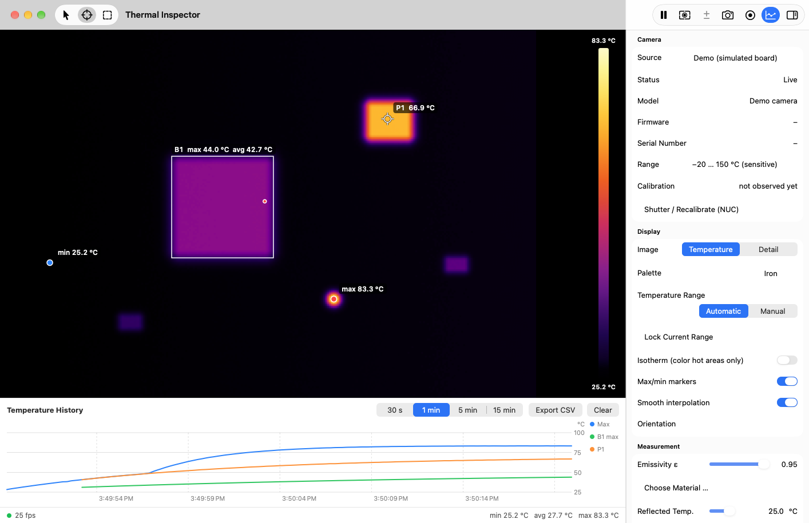

# Thermal Inspector

A native macOS app for the **ThermalMaster P3** USB thermal camera, made for
inspecting circuit boards: find shorts, overheating parts and bad joints.

Written in SwiftUI. It talks to the camera directly via Apple's IOUSBHost
framework – no drivers, Python or libusb needed.



## Features

| Feature | Why it helps on a PCB |
|---|---|
| Live image at 25 fps, 6 color palettes | |
| **Spots** (click) and **boxes** (drag) with live max / average / min – movable with the pointer tool | Watch regulators, ICs, specific parts |
| Hottest / coldest pixel markers | Find the fault without searching |
| **Difference image (ΔT)**: capture the unpowered board, then power it on | Shows only the heating – shorts and leaky capacitors jump out, reflections cancel out |
| **Isotherm**: only areas above a threshold are colored | "Which parts exceed 70 °C?" |
| **Detail view**: the camera's own contrast-enhanced image | Recognize component outlines; measurements still use temperatures |
| Automatic or fixed temperature range | A fixed range keeps images comparable |
| Emissivity with material presets, reflected temperature | Correct readings on solder mask, ICs, ceramics |
| Noise filter (averaging 2–16 frames) | Makes fractions of a degree visible |
| **Drift indicator**: shows how much each automatic recalibration of the camera corrected | Know when readings are trustworthy |
| **Temperature history** chart for all measurements, CSV export | Warm-up behavior, thermal runaway |
| Snapshot: annotated PNG + full temperature matrix (CSV) + results (JSON) | Documentation and later analysis |
| Video recording (MP4, with overlays) | |
| Rotate / mirror | Camera mounted on a stand above the board |
| Gain −20…150 °C (sensitive) or 0…550 °C, shutter / recalibration | |
| English and German, settings window (⌘,) | |
| Demo mode with a simulated board | Try the app without a camera |

## Requirements

* macOS 15 (Sequoia) or newer, Apple Silicon or Intel
* A **ThermalMaster P3** (USB ID `3474:45A2`). These cameras are also sold under
  other names; any camera with this USB ID should work. The P1 (`3474:45C2`) is
  supported by the protocol code but has not been tested.

## Installation

1. Download `Thermal-Inspector-<version>.zip` from the
   [Releases](../../releases) page and double-click it to unzip.
2. Move **Thermal Inspector.app** to your **Applications** folder.
3. Allow the app to open (once) – see below.

### Opening the app for the first time

The app is **not signed with an Apple developer certificate** and not notarized
by Apple. macOS therefore blocks it the first time and says it cannot verify the
app. You have to allow it explicitly – only once:

1. Double-click **Thermal Inspector**. macOS shows a message that the app was
   not opened. Click **Done** (do *not* click "Move to Trash").
2. Open **System Settings → Privacy & Security**.
3. Scroll down to the **Security** section. There is a note that
   "Thermal Inspector" was blocked. Click **Open Anyway**.
4. Confirm with your password or Touch ID, then click **Open Anyway** once more.

From now on the app opens normally.

<details>
<summary>Alternative: Terminal</summary>

Removing the quarantine flag that macOS adds to downloaded files has the same effect:

```bash
xattr -dr com.apple.quarantine "/Applications/Thermal Inspector.app"
```

</details>

**Why unsigned?** Signing and notarizing requires a paid Apple developer
account. If you prefer not to trust a downloaded binary, build the app yourself
from the source code (see below) – that takes about a minute.

## Usage

1. Plug in the camera. The app finds it automatically (also when plugged in later).
2. Choose a tool in the toolbar:
   **Pointer** – read temperatures, drag spots and boxes to move them ·
   **Spot** – click to place · **Box** – drag to draw.
3. Snapshots (⌘S) and videos (⌘R) are saved to `~/Pictures/Thermal Inspector/`
   (configurable in the settings).

No camera at hand? Choose **Demo (simulated board)** as the source.

### Keyboard shortcuts

| | |
|---|---|
| ⌘S | Save snapshot |
| ⌘R | Start / stop video |
| ⌘F | Freeze image |
| ⌘D / ⇧⌘D | Capture reference / toggle difference image |
| ⌘L | Lock current temperature range |
| ⌘K | Shutter / recalibrate |
| ⌘⌫ | Remove all measurements |
| ⌘, | Settings |

### Tips for PCB work

* **Let the camera warm up.** Right after plugging in, the P3 drifts by several
  kelvin between its automatic recalibrations (every ~90 s). The drift indicator
  shows this. For accurate readings wait a few minutes, or press ⌘K right before measuring.
* **Bare metal** (solder, tinned pads, heat sinks) reflects instead of emitting –
  readings are far too low. Put a piece of matte black electrical tape on it and use ε = 0.95.
* **Finding shorts:** capture the reference with the board **off**, power it on and
  watch the ΔT image.
* Use the noise filter and a fixed range when looking for small differences.
* The fixed-focus lens gets blurry very close up; a clip-on macro lens helps for
  fine-pitch parts.

## Building from source

Requires a recent Xcode (tested with Xcode 27; uses macOS 15 APIs) and [XcodeGen](https://github.com/yonaskolb/XcodeGen):

```bash
brew install xcodegen
./build.sh
```

The app is then in `build/Build/Products/Release/`. Alternatively run
`xcodegen generate` and open `ThermalInspector.xcodeproj` in Xcode.

### Development

| | |
|---|---|
| Tests | `xcodebuild -project ThermalInspector.xcodeproj -scheme ThermalInspector -derivedDataPath build test` |
| Translations | All texts live in `ThermalInspector/Resources/Localizable.xcstrings`. After a build, `python3 Tools/check-localizations.py` lists texts without translation. |
| App icon | Generated by `Tools/make-icon.swift` |
| Release zip | `./Tools/make-release.sh` → `dist/` (universal, ad-hoc signed, checks that no local paths end up in the app) |
| Try a language | Launch with `-AppleLanguages "(de)"` |

Code layout:

```
ThermalInspector/
  Camera/     USB protocol, frame assembly, P3 driver, demo camera, camera thread
  Thermal/    Temperature frames, radiometry (emissivity), palettes, rendering
  Analysis/   Measurements, temperature history, calibration (drift) detection
  Export/     Snapshots, annotated images, video recording
  App/        App entry point, central AppModel, preferences
  Views/      SwiftUI views
  Resources/  App icon and translations
ThermalInspectorTests/  Unit tests
Tools/      Icon generator, translation check, release script
docs/       Hardware notes, screenshot
```

## How the camera works

The P3 is not a standard webcam: it uses vendor-specific USB commands and
streams raw temperature data. What is known – including findings made while
building this app (more registers, a firmware debug log, the automatic
recalibration) – is collected in [docs/HARDWARE-NOTES.md](docs/HARDWARE-NOTES.md).

## Credits and license

The USB protocol is a Swift port of the Python driver from
[Thermal Camera Viewer](https://github.com/skywalker1905/thermal-camera-viewer),
which builds on [p3-ir-camera](https://github.com/jvdillon/p3-ir-camera) and the
USB traffic analysis by @aeternium. Thank you!

Made by Timo Schrappe. Licensed under the [Apache License 2.0](LICENSE); see [NOTICE](NOTICE).

This project is not affiliated with or endorsed by ThermalMaster or InfiRay.
Temperature readings of low-cost thermal cameras are approximate – do not rely
on them for safety-critical decisions.
